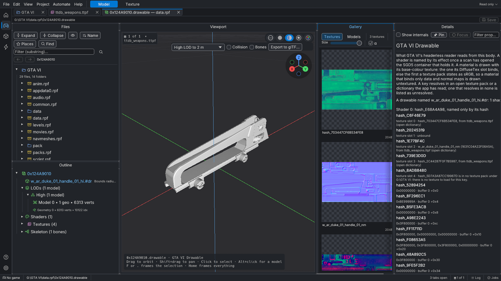

<p align="center">
  <picture>
    <source media="(prefers-color-scheme: dark)" srcset="assets/brand/openrage-full.png" width="180">
    
  </picture>
</p>

<h1 align="center">OpenRage</h1>

<p align="center"><b>Open, edit and save the files of Rockstar's RAGE games.</b><br>One editor, one command line, one Rust library.</p>

<p align="center">
  <a href="https://github.com/openragee/openrage/releases/latest"></a>
  <a href="https://github.com/openragee/openrage/actions/workflows/ci.yml"></a>
  
  
  <a href="LICENSE"></a>
</p>

<p align="center">
  <a href="#download">Download</a> ·
  <a href="#quick-start">Quick start</a> ·
  <a href="#games">Games</a> ·
  <a href="#formats">Formats</a> ·
  <a href="#the-three-programs">Programs</a> ·
  <a href="#good-to-know">Good to know</a> ·
  <a href="#build-from-source">Build</a> ·
  <a href="#documentation">Docs</a>
</p>

<p align="center">
  
</p>

## What you can do

- **Browse a game** as one file tree. Archives are folders.
- **Open** a model, a texture, an animation, an effect, a map, a sound. See it in a 3D viewport.
- **Change it and save it**, without touching the game's own files.
- **Build a mod**: clothing, peds, weapons, maps, effects, as a server resource, a DLC pack or an `.oiv`.
- **Automate it** from a script, another program, an AI agent or a plugin.

Works with **GTA V** (Legacy and Enhanced), **GTA VI** (Xbox Series and PlayStation 5 builds) and, for archives, **Red Dead Redemption 2**.

## Download

Get the package for your system from [the latest release](https://github.com/openragee/openrage/releases/latest).

| System | Package |
|---|---|
| Windows x64 | `.zip`: unzip, run `openrage.exe` |
| Linux x86-64 | `.tar.gz` or `.deb` |
| macOS | `.dmg` (unsigned: macOS asks before the first open) |

- Nothing else to install.
- You need a game you own. OpenRage ships no game file.
- Each package has a `.sha256` checksum beside it.

## Quick start

1. **Open a game.** The start page lists the installs it found. Add a game folder… takes any other.
2. **Open a file.** Double-click it in the tree.
3. **Edit and save.** If the file is in one of the game's own archives, OpenRage offers to copy that archive into the `mods` folder first ([how](docs/features/File_Support.md#the-mods-overlay)).
4. **Make your own content.** Start a project ([Workbench guide](docs/guides/Workbench_Guide.md), also under Help).

> **GTA VI?** OpenRage reads the keys from your own executable (`game_scarlett_master.exe` or `eboot.bin`). The [modding guide](docs/guides/GTA_VI_Modding.md) has the steps.

## Games

✅ works · 🟡 in part · ❌ not yet

| | GTA V Legacy | GTA V Enhanced | GTA VI | Red Dead Redemption 2 |
|---|:-:|:-:|:-:|:-:|
| Browse the install and its archives | ✅ | ✅ | ✅ | ✅ |
| Open and view files | ✅ | ✅ | ✅ | ❌ |
| Edit and save files | ✅ | ✅ | 🟡 | ❌ |
| Decompile scripts | ✅ | ✅ | ✅ | ❌ |
| Viewport lit by the game's own shaders | ✅ | ❌ | 🟡 | ❌ |
| Fly through the world | 🟡 | 🟡 | ✅ | ❌ |
| Edit saves | ❌ | ❌ | 🟡 | ❌ |

- **GTA V.** Both editions, fully. The world is drawn in a plain pass, with none of the game's shaders yet.
- **GTA VI.** Both console builds read the same. Edits are narrow, and no file OpenRage wrote has been tried in the game. Game shaders are for the Xbox Series build only.
- **Red Dead Redemption 2.** Archives only, for now.
- **Older games.** `or-io` reads and writes the archives of GTA III to GTA IV, Max Payne 3, Red Dead Redemption and others. Nothing inside them.

## Formats

Click a game to open its table.

> **`#` is the platform letter.** `.#td` means `.ytd` on PC, `.ztd` on Xbox Series, `.ptd` on PlayStation 5.

<details>
<summary><b>GTA V</b> — Legacy and Enhanced</summary>

<br>

| Kind | Files | Read | Write | In the editor |
|---|---|:-:|:-:|---|
| Models | `.#dr` `.#dd` `.#ft` | ✅ | ✅ | viewport, materials, skeleton, glTF out and back |
| Textures | `.#td` `.dds` | ✅ | ✅ | mips, export, replace, BCn encoding |
| Particle effects | `.#pt` | ✅ | ✅ | simulated preview, timeline |
| Animation | `.#cd` | ✅ | ✅ | clips played on a skeleton |
| Animation data | `.#ed` `.#fd` `.#pdb` `.mrf` | ✅ | ✅ | outline; a `.mrf`'s state machines |
| Collision and cloth | `.#bn` `.#bd` `.#ld` | ✅ | ✅ | outline; `.#bn` and `.#ld` in the viewport |
| Navigation and paths | `.#nv` `.#nd` `.#vr` `.#wr` | ✅ | ✅ | a navmesh in the viewport |
| Maps | `.#map` `.#typ` | ✅ | ✅ | metadata editor, Map and World workspaces |
| Water | `water.xml` `water_*.xml` | ✅ | ✅ | no view yet; `openrage-cli convert` |
| World tables | `heightmap*.dat` `waterheight.dat` `worldblanket.dat` `navprecalc.dat` `distantlights*.dat` | ✅ | ✅ | grids as images, lights as a list |
| Metadata | `.#mt` `.#mf` `.pso` `.meta` `.cut` `.srl` | ✅ | ✅ | metadata editor |
| Text and tables | `.gxt2` `.nametable` `*_cache_y.dat` `metadata.dat` `audioworldsectorsinfo.dat` | ✅ | ✅ | text, or a table |
| Audio | `.awc` `.rel` `.datNN` | ✅ | ✅ | play, export to WAV, replace from WAV; a `.rel` is listed read-only |
| Interface movies | `.gfx` | ✅ | ✅ | tags and imports; SWF out and back |
| Archives | `.rpf` | ✅ | ✅ | browse, extract, replace, create, defragment |
| Video | `.bik` | ✅ | – | plays with its sound |
| Scripts | `.#sc` | ✅ | – | decompiled source, disassembly |
| Shaders | `.fxc`, Enhanced's `sga` container | ✅ | – | a `.fxc`'s outline |
| Other | `.hdr` `ptxclipregions.dat` `materials.dat` | ✅ | – | |

- Any other file opens as text, or read-only as bytes.
- `.#dr` `.#dd` `.#ft` `.#td` `.#pt` differ between Legacy and Enhanced. Both layouts read and write.
- More detail: [File_Support.md](docs/features/File_Support.md).

</details>

<details>
<summary><b>GTA VI</b> — Xbox Series X|S and PlayStation 5</summary>

<br>

| Kind | In the tree | Read | Write | In the editor |
|---|---|:-:|---|---|
| Archives | `.rpf` (RPF9) | ✅ | a patched copy | Files tree, Extract, Save as… |
| Textures | `.ttpf` packs, `.#td` | ✅ | replace, resize, re-encode | Texture workspace |
| Models | `.#dr` `.#ft` `.#dd` | ✅ | materials, bones, geometry from glTF | viewport, glTF out |
| Collision | `.#bn` | ✅ | vertices, masses, materials | viewport, outline |
| Navigation | `.#nv` | ✅ | flags; disable or delete a polygon | navmesh in the viewport |
| Maps | `.#map` `.#typ` | ✅ | move, turn, scale, retype an entity | World workspace |
| Animation | `.#cd`, expressions | ✅ | keys, rate, name, tracks | Animation workspace |
| Cloth and hair | `.#ld` | ✅ | – | viewport |
| Metadata | PSO, RBM, RBF, XML | ✅ | values | metadata editor |
| Text tables | `.#ldb` | ✅ | texts | text |
| Audio | AWC | ✅ | replace a stream from WAV | play, export as Ogg Opus |
| Video | Bink | ✅ | – | plays with its sound |
| Scripts | `.#sc` | ✅ | a number a program pushes | decompiled source, Go to definition, Find references |
| Shaders | shader packs | Xbox only | – | used by the Shaded viewport |
| Weapons | a carrier and its parts | ✅ | – | drawn assembled |
| Saves | a story save, a settings record | ✅ | values | outline editor |

- **Keys.** Archives open with the keys of your own executable. Without them, an archive is only scanned.
- **Saving.** Every write goes to a new file. An edit that fits the body it replaces saves as a *patched copy*, which keeps the game's signed table. Anything else rebuilds the table, and the game refuses it ([what fits](docs/guides/GTA_VI_Modding.md#what-fits-today)).
- **Not tried in the game.** No file OpenRage wrote for GTA VI has been run in the game.
- **Saves.** A plain save and a settings record are edited. A console story save's enciphered payload is deciphered in `or-io` only so far.
- **PlayStation 5.** Reads like Xbox. Only a 2D texture of a pack can be replaced, and its shader packs are refused ([the differences](docs/features/GTA_VI_Builds.md#a-playstation-5-build)).
- More detail: [GTA_VI_Builds.md](docs/features/GTA_VI_Builds.md), [the script decompiler](docs/features/GTA_VI_Script_Decompiler.md), [the world viewer](docs/features/GTA_VI_World_Viewer.md).

</details>

<details>
<summary><b>Red Dead Redemption 2</b></summary>

<br>

| Kind | Read | Write | In the editor |
|---|:-:|:-:|---|
| Archives (RPF8) | ✅ | `or-io` and `openrage-cli rpf create` | browse, extract |
| Resource container (RSC8) | `or-io` only | – | – |
| Texture dictionaries | `or-io` only | – | – |
| Everything else | – | – | text, or bytes |

- The key comes from your own `RDR2.exe`.
- A model or a texture opened from the tree is refused today.
- More detail: [File_Support.md](docs/features/File_Support.md#red-dead-redemption-2).

</details>

<details>
<summary><b>Older games</b> — archives only</summary>

<br>

| Archive | Games |
|---|---|
| RPF0 | Table Tennis |
| RPF2, RPF3, IMG3 | GTA IV |
| RPF3 | Midnight Club: Los Angeles |
| RPF4 | Max Payne 3 |
| RPF6 | Red Dead Redemption |
| IMG1 | GTA III, Vice City |
| IMG2 | San Andreas |

- Read and written by `or-io`. Nothing inside them is decoded.
- The editor lists none of these games.
- More detail: [File_Support.md](docs/features/File_Support.md#earlier-titles).

</details>

## The three programs

### `openrage` — the editor

A desktop app with a workspace for each job: files, models, textures, animation, particles, data, projects, the world.

| | |
|---|---|
| **Viewport** | Wireframe, Solid, Material and Shaded. Shaded uses the game's own shaders ([modes](docs/features/Viewport_Shading_Modes.md)). |
| **World** | A free camera through the active game's world ([GTA VI](docs/features/GTA_VI_World_Viewer.md), [GTA V](docs/features/GTA_V_World_Viewer.md)). |
| **Previews** | Particles ([how](docs/features/Particle_Preview.md)), animation ([how](docs/features/Animation_Preview.md)), audio and video. |
| **Import and export** | glTF for models ([how](docs/features/Mesh_Interchange.md)), DDS for textures ([how](docs/features/BCn_Encoding_And_Mipmaps.md)), WAV for audio, XML for metadata. |
| **Projects** | Clothing, peds, weapons, maps and effects, checked and built ([guide](docs/guides/Workbench_Guide.md), [DLC packs](docs/features/Dlc_Pack_Creation.md)). |
| **Mods** | Edits go to the install's `mods` folder. A panel lists installed mods and their order ([details](docs/features/File_Support.md#the-mods-overlay)). |
| **Plugins** | WebAssembly modules that add panels and commands. You approve what each may do ([plugins](plugins/README.md)). |
| **Languages** | English, Chinese, French, German, Italian, Japanese, Korean, Portuguese, Russian, Spanish ([guide](docs/guides/Interface_Languages.md)). |

### `openrage-cli` — the command line

Everything the editor reads and writes, with no window.

```bash
openrage-cli rpf list x64a.rpf
openrage-cli texture export vehshare.ytd out/
openrage-cli mesh export police.ydr police.glb
openrage-cli meta to-xml peds.ymt peds.xml
```

`openrage-cli <command> --help` explains a command.

<details>
<summary>All commands</summary>

<br>

| To | Commands |
|---|---|
| Look inside | `inspect` `describe` `search` `depends` `names` `hash` `hashes` `formats` `versions` `analyse` `archives` `bounds` `channels` `gaps` |
| Convert | `convert` `meta` `texture` `mesh` `awc` `gfx` `script` `navmesh` `deflate` |
| Work on archives | `rpf` `bulk` `dlc` `dlc-list` |
| Work on GTA VI | `keys` `rpf9` `rpf9-diff` `ttpf` `model` `gta6-project` `gta6-save` `gta6-mission` |
| Build content | `project` `wardrobe` `addonped` `weapons` `maps` `particles` `source` `world` |
| Automate | `serve` `mcp` `photo` |

- `serve` answers other programs over NDJSON ([protocol](docs/reference/CLI_Server_Protocol.md)).
- `mcp` gives an AI agent the same as tools ([install](docs/reference/MCP_Server.md#install)).
- `photo` takes pictures of models with no window.
- Exit codes: 0 success, 1 runtime error, 2 usage error.

</details>

### `or-io` — the Rust library

A file opens as an ordinary value. Read a field, assign it, save.

```rust
use or_io::gta5::*;

let mut car = GtaDrawable::open("police.ydr")?;   // a Legacy drawable
println!("{} {:?}", car.name, car.lod_group.lod_distances);
car.lod_group.lod_distances[0] = 45.0;            // plain assignment
car.lod_group.lods[0].models.remove(1);           // structural edits are Vec operations
car.save()?;                                      // validated, canonical form
```

- Errors come only at open and at save.
- `GtaDrawable::<Gen9>` is the Enhanced layout. `or_io::open` picks the layout from the file.
- Not on crates.io yet: depend on it by git. Its API still moves.
- Design: [OR_IO_Specification.md](docs/direction/OR_IO_Specification.md). Crate: [crates/io/or-io](crates/io/or-io).

## Good to know

- **Pre-1.0.** Things still move.
- **Tested on real files, mostly not in a running game.** A saved file reads back the same. That does not prove the game loads it. [The acceptance sheet](docs/guides/In_Game_Acceptance.md) lists what a person checked in game.
- **A save is OpenRage's own form of the file**, not a byte copy of the shipped one. Saving again gives the same bytes.
- **Your game stays untouched.** OpenRage downloads nothing and installs nothing on its own.
- **Read-only for now:** scripts, `.fxc` shaders, `.bik` video.

**Coming next** ([roadmap](docs/direction/Roadmap.md)):

- a world editor for GTA V maps ([plan](docs/direction/World_Editor_Plan.md))
- one world viewer and editor for every game, drawn with each game's own shaders ([plan](docs/direction/Unified_World_Plan.md))
- Red Dead Redemption 2's files

## Build from source

You need the Rust toolchain (rustup picks the pinned nightly), [just](https://github.com/casey/just) and `cargo install cargo-nextest --locked`. On Linux, also ALSA's headers (`libasound2-dev`).

```bash
just build        # release build
just dev          # run the editor
just self-check   # draw every panel, with no window
just ready        # the checks before a merge
just test         # every test: about twenty minutes
```

- No game file is in the repository. Tests that need real files skip on a clean clone, and a skip is not a pass ([staging a corpus](crates/io/or-io-verify/tests/fixtures/README.md), [what a clone lacks](docs/guides/Private_Tier.md)).
- Mirror on [Radicle](https://radicle.network/nodes/oak.radicle.garden/rad:zhdibp82Y5a4zqi44zZuJA6mt8tm): `rad clone rad:zhdibp82Y5a4zqi44zZuJA6mt8tm`.

<details>
<summary>Repository layout</summary>

<br>

Dependencies run one way: foundation → io → title → domain → runtime → app.

| Layer | Holds | Crates |
|---|---|---|
| app | the editor and the `openrage-cli` entry point | [src](src) |
| [runtime](crates/runtime) | what is evaluated, simulated or drawn | or-anim, or-renderer, or-simulation |
| [domain](crates/domain) | what is edited, and what a project builds | or-project, or-source, or-content, or-wardrobe, or-addonped, or-weapons, or-maps, or-particles, or-particle, or-world, or-world-gta5, or-world-gta6, or-worlds, or-depends, or-interchange, or-editor, or-plugin |
| [title](crates/title) | a game install: editions, archives, DLC order | or-title |
| [io](crates/io) | file formats, archives, media decoders | or-io, or-io-macros, or-io-verify, or-kraken, or-media |
| [foundation](crates/foundation) | building blocks that know no format | or-job, or-transport, or-test-support |
| [tools](crates/tools) | programs beside the chain | or-cli, or-shader-tool, or-shader-front, xtask |

[Crate_Reference.md](docs/reference/Crate_Reference.md) describes each crate.

</details>

## Contributing

Issues and pull requests are welcome.

- **Reporting a bug?** Give the file's name and where it shipped (game, edition, archive path). Do not attach game files.
- **Writing code?** Read [AGENTS.md](AGENTS.md) and [the development workflow](docs/guides/Development_Workflow.md). `just ready` is the gate.
- **Adding a format?** Follow [the format guide](docs/guides/New_Format_Implementation_Guide.md).
- **Translating?** See [the languages guide](docs/guides/Interface_Languages.md).
- **Borrowing from another tool?** Check [the licence and provenance policy](docs/guides/Licence_And_Provenance_Policy.md) first.

## Documentation

| I want to… | Read |
|---|---|
| see every document | [docs/](docs/README.md) |
| know what a file kind supports | [File_Support.md](docs/features/File_Support.md) |
| make clothing or another mod | [Workbench guide](docs/guides/Workbench_Guide.md) |
| mod GTA VI | [GTA VI modding guide](docs/guides/GTA_VI_Modding.md), [GTA_VI_Builds.md](docs/features/GTA_VI_Builds.md) |
| check a mod in the game | [acceptance sheet](docs/guides/In_Game_Acceptance.md) |
| drive OpenRage from a program | [CLI server protocol](docs/reference/CLI_Server_Protocol.md), [MCP server](docs/reference/MCP_Server.md) |
| write a plugin | [Plugin ABI](docs/reference/Plugin_ABI.md), [plugins/](plugins/README.md) |
| see what is planned | [Roadmap](docs/direction/Roadmap.md) |

RAGE's binary layout specifications are kept out of the repository ([why](docs/guides/Private_Tier.md)).

## Licence

**MIT** — see [LICENSE](LICENSE). Third-party notices: [LICENSE-third-party.md](LICENSE-third-party.md).

OpenRage is unofficial. It is not affiliated with, endorsed by, or connected to Rockstar Games or Take-Two Interactive. "Grand Theft Auto" and "Red Dead Redemption" are trademarks of their respective owners. No game assets are distributed with this software; it operates on files the user already owns.

<details>
<summary>The exception, and where keys come from</summary>

<br>

- **`crates/io/or-media` is AGPL-3.0-only.** It decodes the audio and video. It holds code ported from FFmpeg (LGPL-2.1-or-later) and from NihAV (AGPL-3.0), and a Bink 2 filter derived from RAD's proprietary `bink2w64.dll` for interoperability. The editor and the CLI link it, in a release's packages too, and what that asks of them is not reviewed yet ([policy](docs/guides/Licence_And_Provenance_Policy.md)).
- **BCPack.** The decoder of BCPack texture bodies is ported from [bcpack-rs](https://github.com/Ahmet-Dedeler/bcpack-rs) by Ahmet Dedeler.
- **Keys.** OpenRage extracts the keys it can from the user's own game executable. The rest come from the key snapshots OpenRage bundles, CodeWalker's for GTA V among them, or from one the user supplies. A bundled snapshot is encrypted under a key taken from the user's executable, so it opens nothing without the game.

</details>
